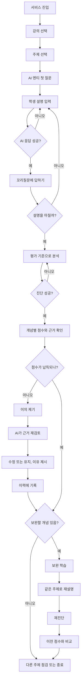

# PRD_명티

**명티(MJ-Tee): 배운 걸 가르치면서 측정하는 AI 학습 이해도 진단 서비스**

---

# 1. 프로젝트 개요

**문제**
AI의 설명을 읽는 방식의 학습은 '이해한 느낌'만 남기기 쉽고, 학생 스스로 어떤 개념을 얼마나 이해했는지 객관적으로 확인할 방법이 부족하다.

**필요성**
- AI의 설명은 정리되어 있고 매끄러워서 읽는 순간에는 이해했다고 느끼지만, 시험이나 발표에서 스스로 설명하려 하면 막힌다.
- AI를 많이 활용할수록 오히려 자신이 무엇을 알고 무엇을 모르는지 파악하기 어려워진다.
- 대학생 400명 조사에서 ChatGPT 사용 경험은 97%, 주 1회 이상 사용은 약 80%로, 생성형 AI가 학습 전반에 보편화되었다. [1]
- 이해도를 확인하는 가장 확실한 방법은 남에게 설명해 보는 것이다. 설명이 막히는 지점이 곧 이해가 부족한 지점이다. 가상의 학생을 가르칠 때 더 많이 노력하고 더 깊이 이해한다는 '프로테제 효과'도 보고되어 있다. [2]
- 교내 멘토링은 정해진 시간에만 이루어져, 혼자 복습하는 대부분의 시간에는 설명을 들어 주고 되물어 줄 상대가 없다.
- 설명을 마친 뒤에도 어느 개념이 얼마나 부족한지 확인할 방법이 없다.

**목적**
- AI를 답을 주는 도구가 아니라 자신의 이해도를 점검하는 상대로 쓰게 한다.
- 학생이 개념별로 아는 것과 모르는 것을 점수와 근거로 구분하게 한다.
- 학생이 AI의 평가까지 직접 검증하게 한다.
- 보완 학습 후 다시 설명해 자신의 성장을 확인하게 한다.

**한 줄 정의**
명지대학교 학생이 강의 개념을 AI 멘티에게 직접 설명해, 개념별 이해도를 근거와 함께 진단받고 재설명으로 성장을 확인하게 해주는 웹 서비스

**일반 챗봇과 다른 점**
1. 핵심 개념 목록을 기준으로 채점해 어떤 개념이 빠졌는지 드러난다.
2. 모든 점수에 학생의 설명 문장을 인용한 근거가 붙고, 이의를 제기하면 AI가 근거를 다시 검토한다.
3. 보완 학습 후 재설명 점수가 이전과 비교되어 기록으로 남는다.

---

# 2. 주요 타겟

**대상:** 강의 개념이나 프로젝트 내용을 복습·점검하려는 명지대학교 재학생

**대표 사용자 프로필**

| 항목 | 내용 |
|---|---|
| 인물 | 김명지, 명지대학교 2학년, 전공기초 과목 수강 중 (가상 인물, 가정) |
| 사용 상황 | 중간고사 일주일 전 평일 저녁, 도서관에서 혼자 복습하다가 제대로 이해했는지 확인하고 싶을 때 (시기와 장소는 가정). 멘토링 시간이 아니어서 설명을 들어 줄 상대가 없다 |
| 사용 기기 | 노트북 웹 브라우저 (가정, 제안서는 웹 서비스로 명시) |
| 지금 해결 방법 | 모르는 개념을 AI에게 묻고 설명을 읽는다. 읽을 때는 이해한 것 같지만 시험 전까지 확인하지 못한다 |
| 회원가입 | 귀찮아한다. 복습 중에 바로 쓰고 싶어 가입 절차가 길면 이탈한다 (가정) |

**그 밖의 사용 상황:** 과제·프로젝트 발표 리허설, 튜터링/멘토링 프로그램 참여

---

# 3. 핵심 기능 (MVP)

제안서가 내세운 차별점 세 가지를 모두 담기 위해 세 기능을 필수로 둔다. 우선순위는 구현 순서다.

| 우선순위 | 기능 | 완료 기준 |
|---|---|---|
| 1 (필수) | **AI 멘티 설명 세션**: 강의와 주제를 고르고, 후배 역할의 AI 멘티에게 설명하며 꼬리질문을 받는다 | AI 멘티가 정답을 알려 주지 않고, 주제의 핵심 개념마다 꼬리질문을 1개 이상 던진다 |
| 2 (필수) | **근거 기반 이해도 진단과 이의 제기**: 미리 정의한 평가 기준으로 하위 개념별 점수를 내고, 학생이 점수에 이의를 제기할 수 있다 | 모든 점수에 학생 설명의 인용 근거가 붙고, 이의를 제기하면 점수 수정 또는 유지 결과가 이유와 함께 나오며 이력에 남는다 |
| 3 (필수) | **보완 학습과 재설명 비교**: 점수가 낮은 개념을 중심으로 보완 학습을 제안하고, 재설명 점수를 이전 점수와 비교한다 | 낮은 개념 순으로 보완 학습이 제안되고, 재설명 후 개념별 이전·현재 점수가 함께 기록되어 보인다 |

**없어도 되는 기능 (시간이 남을 때 구현)**

| 기능 | 이유 |
|---|---|
| 강의 자료(PDF)에서 개념 자동 추출 | 제안서에서 보조 기능으로 계획. 시범 강의는 핵심 개념과 평가 기준을 직접 구축하므로 없어도 전체 흐름이 동작한다 |

**구현 전제**
- **기술:** Next.js 기반 웹 서비스. AI 멘티 대화와 채점에는 OpenAI API를 사용한다.
- **시범 범위:** 개념 구조가 명확한 전공기초 과목 1~2개. 과목은 미정이다.
- **사전 구축 데이터:** 주제별로 반드시 포함되어야 할 핵심 개념과 평가 기준을 미리 정의한다.
- **제작 일정 (3주):**
  - 1주차: 시범 강의 선정, 핵심 개념·평가 기준 작성, AI 멘티와 채점 프롬프트 설계
  - 2주차: 설명, 진단 결과, 이의 제기, 재설명 비교 화면 구현
  - 3주차: 시범 테스트 후 질문 방식과 채점 기준 보완

---

# 4. 사용자 흐름

사용자 역할은 **학생** 하나다. 시범 강의 데이터는 제작 단계에서 미리 넣으므로 관리자 역할은 없다. AI 처리 단계는 **[시스템]** 으로 표시한다. 예외 상황은 모두 (가정)이다.

## 4-1. 설명과 진단

1. 학생이 서비스에 들어온다.
2. 학생이 수강 중인 강의를 고른다.
3. 학생이 점검할 주제를 고른다.
   - 예외: 준비된 강의나 주제가 없으면 시범 운영 범위를 안내한다.
4. 학생이 "설명 시작하기"를 누른다.
5. [시스템] AI 멘티가 후배 말투로 첫 질문을 보낸다.
6. 학생이 자기 말로 개념을 설명해 보낸다.
   - 예외: 빈 메시지는 보낼 수 없다.
   - 예외: 1,000자를 넘으면 더 입력되지 않는다.
7. [시스템] AI 멘티가 설명의 빈틈을 파고드는 꼬리질문을 보낸다.
   - 예외: 응답에 실패하면 작성한 메시지를 유지하고 다시 보내기 버튼을 보여 준다.
   - 예외: 학생이 "정답을 알려 줘"라고 해도 답을 주지 않고 다시 질문한다.
8. 학생이 꼬리질문에 답한다.
9. 학생이 핵심 개념을 다룰 때까지 6~8번을 반복한다.
10. 학생이 "설명 마치고 진단받기"를 누른다.
    - 예외: 다루지 않은 핵심 개념이 있으면 그대로 마칠지 확인한다.
11. [시스템] 평가 기준에 따라 설명과 답변을 분석한다.
    - 예외: 진단에 실패하면 대화를 보존하고 다시 진단 버튼을 보여 준다.
12. 학생이 하위 개념별 점수를 본다.
13. 학생이 각 점수의 인용 근거를 확인한다.

## 4-2. 이의 제기

1. 학생이 납득되지 않는 개념에서 "이 평가에 이의 제기"를 누른다.
   - 예외: 같은 진단의 같은 개념에 이미 이의를 제기했다면 버튼 대신 "이의 제기 완료"가 표시된다.
2. 학생이 이의 제기 이유를 입력한다.
   - 예외: 이유가 비어 있으면 보낼 수 없다.
3. 학생이 "다시 검토 요청"을 누른다.
4. [시스템] AI가 근거를 다시 검토한다.
   - 예외: 검토에 실패하면 입력한 이유를 유지하고 다시 요청 버튼을 보여 준다.
5. [시스템] 점수를 수정하거나 유지하고 그 이유를 보여 준다.
6. [시스템] 이의 제기 내용과 결과를 이력에 남긴다.
7. 학생이 이력을 확인한다.

## 4-3. 보완과 재설명

1. 학생이 "보완 학습 보기"를 누른다.
   - 예외: 보완할 개념이 없으면 다른 주제를 점검하도록 안내한다.
2. 학생이 점수가 낮은 개념부터 보완 학습 제안을 읽는다.
3. 학생이 제안에 따라 복습한다.
4. 학생이 "다시 설명하기"를 누른다.
5. 학생이 같은 주제로 새 세션을 진행한다. (4-1의 5~11번과 같음)
6. [시스템] 재설명 점수를 이전 점수와 비교한다.
7. 학생이 성장 확인 화면에서 변화를 본다.
8. 학생이 "다른 주제 점검하기"를 누르거나 서비스를 닫는다.

## 4-4. 순서도

---

# 5. 입력과 출력

제안서는 화면 구성과 기능을 정하고 있으며, 글자 수 제한·문구·색·점수 구간은 정하지 않았다. 이 장의 **글자 수, 버튼 문구, 오류 문구, 색, 점수 구간은 모두 (가정)** 이다.

**공통 색상과 점수 구간**

| 구분 | 색 | 쓰는 곳 |
|---|---|---|
| 충분 (80점 이상) | 남색 | 점수, 주요 버튼, 학생 말풍선 |
| 보통 (60~79점) | 하늘색 | 점수, 꼬리질문, 인정 근거 |
| 보완 필요 (60점 미만) | 코랄 | 점수, 감점 근거, 빠진 개념, 오류 문구 |

## S1. 강의·주제 선택

| 입력 (형식·제한) | 처리 | 출력 (문구·색·버튼) |
|---|---|---|
| 강의: 목록에서 1개 선택 | 강의의 주제 목록 불러오기 | 안내 "어떤 강의를 점검할까요?" |
| 주제: 목록에서 1개 선택 | 주제의 핵심 개념과 평가 기준 불러오기 | 핵심 개념 목록. 버튼 "설명 시작하기" (남색 배경, 흰 글자). 선택 전에는 비활성화 |

| 오류 상황 | 오류 문구 |
|---|---|
| 불러오기 실패 | 강의 목록을 불러오지 못했어요. 다시 시도해 주세요. (버튼 "다시 시도") |
| 준비된 강의나 주제 없음 | 지금은 시범 강의만 점검할 수 있어요. (시범 강의 목록 표시) |

## S2. AI 멘티에게 설명하기 (제안서 화면 1)

| 입력 (형식·제한) | 처리 | 출력 (문구·색·버튼) |
|---|---|---|
| 설명 메시지: 텍스트, 1~1,000자 | 대화 저장. AI가 처음 배우는 후배 역할로, 정답 없이 질문만 생성 | 학생 말풍선 (남색 배경, 흰 글자). 전송 버튼 (남색) |
| 없음 (AI 질문) | 설명의 빈틈을 찾아 꼬리질문 생성 | 예: "그건 왜 그런가요?", "그럼 이 경우엔 어떻게 되나요?" 꼬리질문은 하늘색 테두리와 라벨 "꼬리질문" |
| 없음 (진행 상태) | 다룬 핵심 개념 판별 | 오른쪽 개념 목록에 "완료", "검증 중" (하늘색) 표시 |
| 종료 버튼 클릭 | 대화를 채점 단계로 전달 | 버튼 "설명 마치고 진단받기" (남색 배경, 흰 글자) |

| 오류 상황 | 오류 문구 |
|---|---|
| AI 응답 실패 | 멘티가 답을 하지 못했어요. 작성한 내용은 그대로 있어요. (버튼 "다시 보내기") |
| 다루지 않은 개념 있음 | 아직 설명하지 않은 개념이 N개 있어요. 이대로 진단받을까요? (버튼 "계속 설명하기", "진단받기") |

## S3. 이해도 진단 결과와 이의 제기 (제안서 화면 2)

| 입력 (형식·제한) | 처리 | 출력 (문구·색·버튼) |
|---|---|---|
| 없음 (세션 대화) | 평가 기준에 따라 하위 개념별 점수 산출, 학생 문장 인용 | 안내 "AI의 평가도 틀릴 수 있어요. 점수보다 근거 문장을 먼저 확인해 보세요." 종합 점수, 개념별 점수 (구간 색) |
| 개념 행 클릭 | 근거 펼치기 | 인용 근거 "인정" (하늘색 선), "감점" (코랄 선), 빠진 내용 (코랄 제목) |
| 이의 제기 이유: 텍스트, 1~500자, 진단·개념당 1회 | 기존 근거, 평가 기준, 학생 이유를 함께 AI가 재검토 | 링크 "이 평가에 이의 제기". 입력창과 버튼 "다시 검토 요청" (남색). 이유가 비어 있으면 버튼 비활성화. 이미 제기한 개념은 링크 대신 "이의 제기 완료" 표시 |
| 없음 (재검토 결과) | 점수 수정 또는 유지, 이유 생성, 이력 저장 | "점수를 수정했어요 (이전 → 현재)" 또는 "점수를 유지했어요" + 이유. "이의 제기 이력" 목록 |
| 버튼 클릭 | 보완 학습으로 이동 | 버튼 "보완 학습 보기" (남색 배경, 흰 글자) |

| 오류 상황 | 오류 문구 |
|---|---|
| 진단 실패 | 진단을 만들지 못했어요. 대화는 저장되어 있어요. (버튼 "다시 진단") |
| 재검토 실패 | 다시 검토하지 못했어요. 입력한 내용은 그대로 있어요. (버튼 "다시 요청") |
| 설명하지 않은 개념 | 설명하지 않음 (인용할 근거가 없어 점수 없이 표시, 종합 점수에서 제외) |

## S4. 보완 학습 (제안서 화면 3)

| 입력 (형식·제한) | 처리 | 출력 (문구·색·버튼) |
|---|---|---|
| 없음 (진단 결과) | 점수가 낮은 개념 순으로 정렬, 보완 학습 제안 생성 | 개념명, 점수 (구간 색), 부족한 이유, 빠진 내용, 다시 볼 강의 자료 위치 |
| 없음 | 재설명 전 점검 질문 생성 | 자기 점검 질문 (하늘색 왼쪽 선) |
| 버튼 클릭 | 같은 주제로 새 세션 생성 | 버튼 "다시 설명하기" (남색 배경, 흰 글자) |

| 상황 | 문구 |
|---|---|
| 보완할 개념 없음 | 보완이 필요한 개념이 없어요. 다른 주제도 점검해 볼까요? (버튼 "다른 주제 선택") |

## S5. 성장 확인 (제안서 화면 4)

| 입력 (형식·제한) | 처리 | 출력 (문구·색·버튼) |
|---|---|---|
| 없음 (이전·재설명 결과) | 종합·개념별 점수 차이 계산 후 기록 저장 | 종합 점수 "이전 → 현재" (이전 회색, 현재 남색), 증가폭 "+N" (하늘색), 개념별 점수 비교 차트 |
| 없음 | 이전과 재설명 문장 비교 | "달라진 설명": 이전 설명과 재설명을 나란히 표시 |
| 버튼 클릭 | 주제 선택으로 이동 | 버튼 "다른 주제 점검하기" (남색 배경, 흰 글자) |

| 오류 상황 | 오류 문구 |
|---|---|
| 재설명 기록 없음 | 아직 다시 설명한 기록이 없어요. (버튼 "다시 설명하기") |

## 저장하는 데이터

| 데이터 | 저장 위치 (가정) | 볼 수 있는 사람 (가정) |
|---|---|---|
| 핵심 개념, 평가 기준 | 서비스에 사전 탑재 | 핵심 개념은 전체 사용자, 평가 기준은 제작자 |
| 대화, 점수, 근거, 재설명 비교 기록 | 사용자 브라우저. 대화는 질문과 채점을 위해 OpenAI API로 전송 | 사용자 본인 |
| 이의 제기 이력 | 사용자 브라우저 | 사용자 본인 |

---

# 6. 제외 범위 (Out of Scope)

이번 버전에서 만들지 않는다. AI로 구현할 때 임의로 추가하지 않는다.

| # | 제외 기능 | 근거 | 2차 버전 |
|---|---|---|---|
| 1 | 로그인, 회원가입 | (가정) 대표 사용자가 가입을 귀찮아함. 기록은 브라우저에 저장 | ✅ 2차 |
| 2 | LMS 연계 | 제안서의 확산 방안. 수강 강의 기준 접근은 시범 운영 이후 | ✅ 2차 |
| 3 | 알림 (이메일, 푸시, 복습 알림) | (가정) 제안서에 없음 | |
| 4 | 교수자 기능 (강의 자료 넣어 보기, 학생 공통 취약 개념 집계) | 제안서의 기대효과. 진단 결과가 쌓인 뒤에 가능 | ✅ 2차 |
| 5 | 시범 외 과목 확대 (단과대학별 주요 과목, 교양 과목) | 제안서의 단계적 확대 방안 | ✅ 2차 |
| 6 | 튜터링/멘토링 프로그램 전용 기능 | 제안서의 확산 방안. 이번 버전은 개별 학생 점검에 집중 | ✅ 2차 |
| 7 | 앱, 모바일 전용 화면 | 제안 유형이 웹 | |
| 8 | 결제, 소셜 기능 | (가정) 제안서에 없음 | |

✅ 표시가 없는 항목은 2차 버전에서도 예정하지 않는다.

---

# 7. PRD 점검표

## 7-1. 점검 결과

| 점검 항목 | 수정 전 | 현재 | 근거 |
|---|---|---|---|
| 문제를 한 문장으로 말할 수 있는가? | 미흡 (3문장) | 충족 | 1장 "문제"를 한 문장으로 줄이고 나머지는 필요성으로 옮김 |
| 사용자를 특정 인물로 적었는가? | 미흡 (집단 설명) | 충족 | 2장에 가상 인물 김명지와 구체적인 사용 상황을 적음. 실제 사용자 조사 결과는 아님 |
| MVP 기능이 3개 이하인가? | 충족 | 충족, 단 주의 | 3장에 3개. 다만 한 기능에 여러 기능을 묶어 실제 작업량은 3개보다 많음 |
| 모든 화면에 입력과 출력이 있는가? | 대체로 충족 | 충족 | S1~S5 모두 있음. 성장 확인의 다음 행동 버튼과 누락된 예외 문구를 추가함 |
| 제외 범위가 3개 이상인가? | 충족 | 충족 | 6장에 8개 |

## 7-2. 점검표 자체에 대한 판단

이 점검표는 PRD에 필요한 내용이 **있는지** 확인하는 최소 기준으로 유용하다. 다만 내용이 **타당한지**는 확인하지 못한다.

| 항목 | 한계 | 이 PRD에서의 대응 |
|---|---|---|
| 문제 한 문장 | 문장이 있어도 실제 사용자의 문제인지는 알 수 없음 | 3주차 시범 테스트에서 확인 |
| 특정 인물 | 가상 인물을 만들기만 해도 통과함 | 가상 인물임을 명시 |
| MVP 3개 이하 | 기능을 묶으면 개수만 줄어듦 | 3장의 우선순위대로 구현하고, 일정이 부족하면 3번 기능의 보완 학습 제안 내용부터 줄임 (가정) |
| 입력과 출력 | 표만 있으면 통과하며, 흐름과 맞는지는 보지 않음 | 4장의 흐름과 5장의 화면을 대조함 |
| 제외 범위 3개 | 개수보다 임의로 붙기 쉬운 기능이 들어갔는지가 중요함 | 로그인, 외부 연동, 알림을 포함함 |

## 7-3. 추가 점검 항목

위 점검표로 잡히지 않는, 이 서비스에 중요한 항목이다.

| 점검 항목 | 결과 | 남은 일 |
|---|---|---|
| 완료 기준을 실제로 확인할 수 있는가? | 대부분 충족 | "정답을 알려 주지 않는다"는 시범 테스트에서 시도해 확인 |
| AI 채점이 일관적인가? | **미충족** | 제안서는 평가 기준을 미리 정의하기로 했지만 일관성을 재는 기준이 없음. 같은 대화를 3번 채점해 개념별 점수 차이가 10점 이내인지 확인하는 안을 제안함 (가정) |
| `(가정)`이 확정되었는가? | **미충족** | 대표 사용자, 로그인 제외, 5장의 세부 값 확정 필요 |
| 필요한 사전 데이터가 준비되었는가? | **미충족** | 시범 과목 선정, 핵심 개념과 평가 기준 작성 필요 |

---
